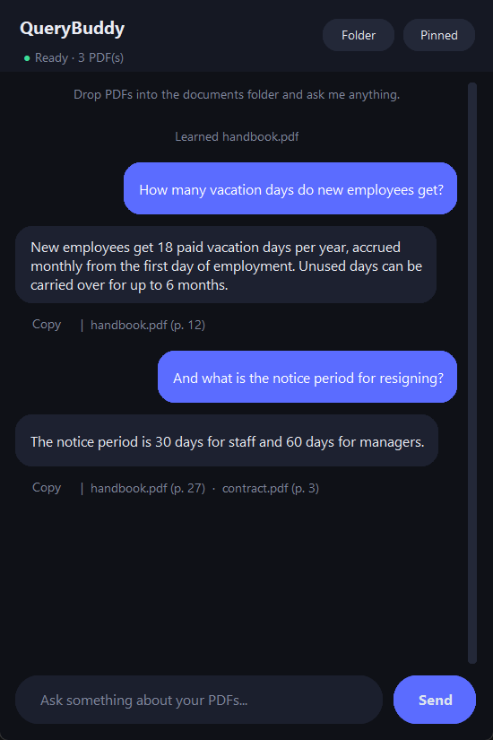

# QueryBuddy

A small desktop chat widget that answers questions from your own PDFs.
Drop PDFs into a folder, ask in plain language, get an answer with the file and page it came from.

<p align="center">
  
</p>

> The screenshot uses made-up demo content.

## How it works

This is a small RAG (retrieval-augmented generation) pipeline:

1. PDFs in `documents/` are read page by page and cut into overlapping chunks.
2. Chunks are stored in a local [ChromaDB](https://www.trychroma.com/) database (`chroma_db/`).
3. When you ask a question, the most relevant chunks are retrieved.
4. Those chunks plus your question are sent to an LLM, which answers using only that text and says so when the answer is not in your documents.

The widget watches the folder every few seconds. Add a PDF and it is learned, delete one and it is forgotten.

## Features

- Modern dark desktop widget (customtkinter) that stays on top, with a pin toggle
- Answers show their sources (file name and page)
- Works with any OpenAI-compatible provider: OpenRouter, Groq, OpenAI, Ollama, and others
- Model fallback list, so a rate-limited free model does not stop you
- Everything stays local except the question and the retrieved excerpts sent to your chosen LLM

## Setup

Requires Python 3.10+.

```bash
pip install -r requirements.txt
```

Copy the example settings and add your key:

```bash
cp .env.example .env
```

Edit `.env`:

```
LLM_API_KEY=your-key-here
LLM_BASE_URL=https://openrouter.ai/api/v1
LLM_MODEL=google/gemma-4-31b-it:free,google/gemma-4-26b-a4b-it:free
```

`.env` is gitignored, so your key is never committed.

## Run

Put some PDFs in the `documents/` folder, then:

```bash
python Main.py
```

## Configuration

All settings live in `.env`.

| Variable | Meaning |
|---|---|
| `LLM_API_KEY` | API key for your provider |
| `LLM_BASE_URL` | Provider endpoint (any OpenAI-compatible URL) |
| `LLM_MODEL` | One model, or several separated by commas. Later ones are used if earlier ones fail |
| `LLM_MAX_TOKENS` | Maximum reply length (default 512, some providers cap it) |

Example providers:

| Provider | `LLM_BASE_URL` |
|---|---|
| OpenRouter | `https://openrouter.ai/api/v1` |
| Groq | `https://api.groq.com/openai/v1` |
| OpenAI | `https://api.openai.com/v1` |
| Ollama (local) | `http://localhost:11434/v1` |

Chunk size, number of retrieved chunks and the folder check interval are in [config.py](config.py).

## Project structure

```
QueryBuddy/
├── Main.py              entry point
├── config.py            settings, loaded from .env
├── documents/           put your PDFs here
├── assets/              README screenshot
├── gui/
│   ├── app.py           window, wiring, background work
│   ├── chat_view.py     message bubbles, typing indicator
│   └── theme.py         colors and fonts
└── services/
    ├── pdf_reader.py    PDF text extraction and chunking
    ├── vector_store.py  ChromaDB, folder sync, search
    ├── llm.py           model calls with fallback
    └── rag.py           question to answer pipeline
```

The code is plain functions, no classes.

## Notes and limits

- The default ChromaDB embedding model is English-focused, so search quality on non-English PDFs (for example Bengali) can be weaker. A multilingual embedding model would improve this.
- Scanned PDFs without a text layer are not readable; they need OCR first.
- Free models can be rate limited. Listing several in `LLM_MODEL` helps.
